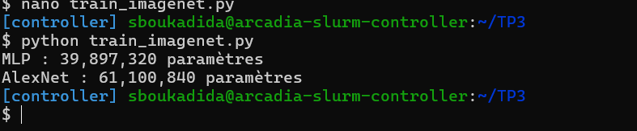
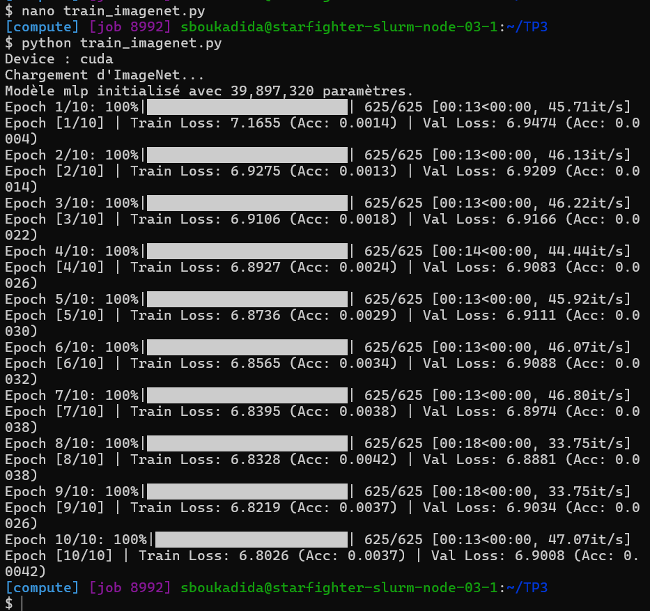
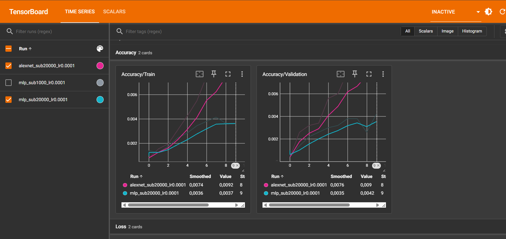
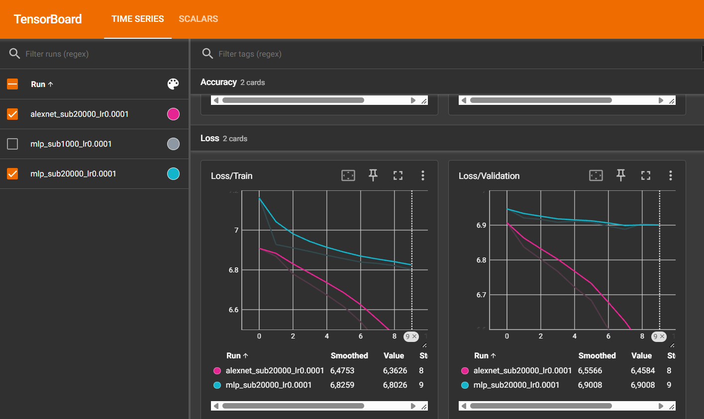
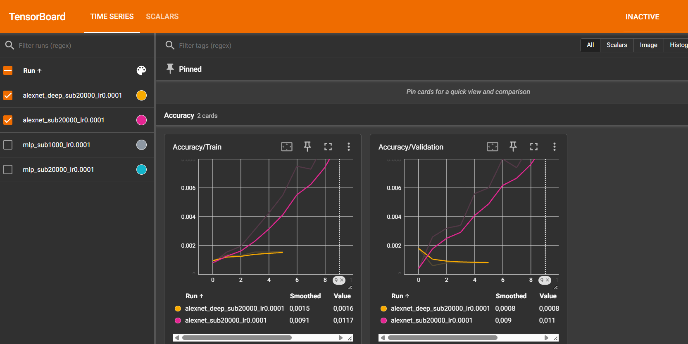
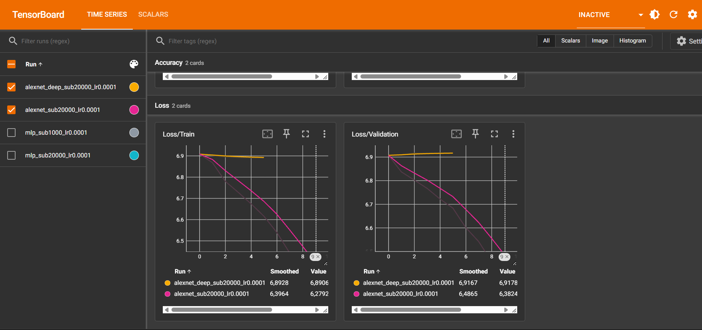
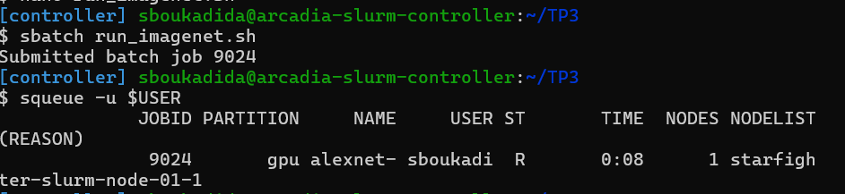
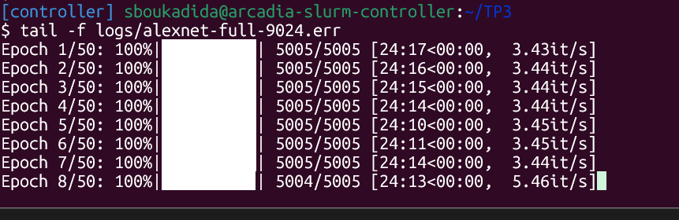
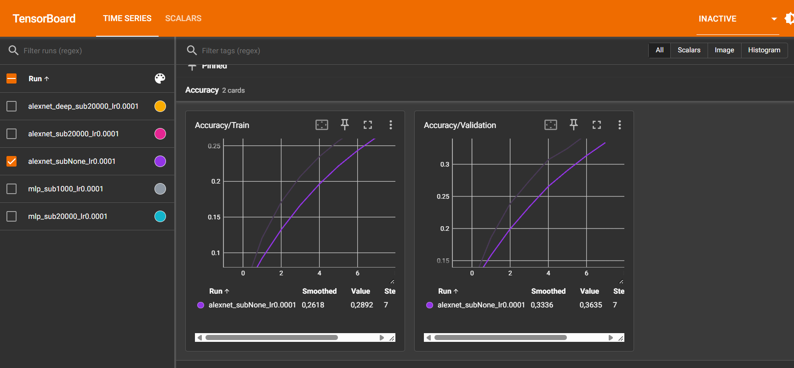
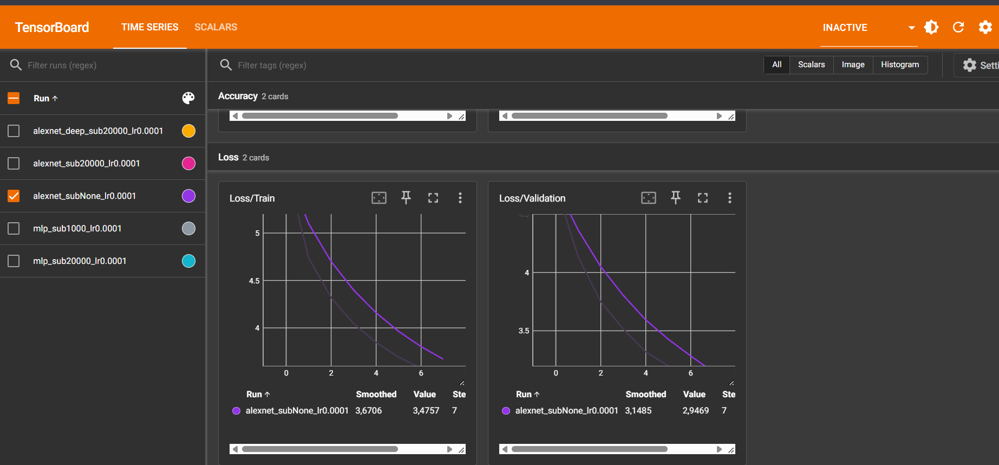

## Exercice 1 : Préparation d'ImageNet et augmentation de données

### Question 1.a

**1. Pourquoi normaliser les données ? Pourquoi utiliser uniquement les statistiques du train ?**

Sans normalisation, les gradients peuvent être mal équilibrés, ce qui ralentit la convergence et peut rendre l'entraînement moins stable.

On calcule les moyennes et écarts-types uniquement sur le train pour éviter la fuite de données (*data leakage*) et garder une évaluation fiable.

**2. Pourquoi utiliser des transformations différentes pour le train et la validation ?**

Pour le train, `RandomResizedCrop` et `RandomHorizontalFlip` permettent de varier les images afin de limiter le sur-apprentissage et d'améliorer la généralisation.

Pour la validation, `Resize` et `CenterCrop` garantissent des images identiques à chaque évaluation, ce qui permet de comparer les résultats correctement.

**3. Exemple où `RandomHorizontalFlip` serait néfaste**

La classification de panneaux de signalisation indiquant une direction (tourner à gauche ou tourner à droite).

Un retournement horizontal transformerait un panneau « tourner à gauche » en « tourner à droite », tout en conservant son étiquette initiale. Cela introduirait des erreurs d'étiquetage et pourrait dégrader l'apprentissage du modèle.

## Exercice 2 : Étude théorique et implémentation des architectures

### Question 2.a – MLP

**1.**

- Couche 1 : (154 587 × 256) + 256 = 39 574 528
- Couche 2 : (256 × 256) + 256 = 65 792
- Couche 3 : (256 × 1000) + 1000 = 257 000

**Total avec biais : 39 897 320 paramètres.**

**Total sans biais : 39 895 808 paramètres.**

La première couche concentre environ 99,2 % des paramètres, car elle reçoit directement tous les pixels de l'image aplatie.

**2.**

En aplatissant l'image, le MLP perd sa structure spatiale : il ne tient pas compte directement des relations entre pixels voisins. Il a donc plus de difficulté à reconnaître des motifs locaux comme les contours et les textures.

### Question 2.b

**1. Dimensions, paramètres et mémoire des couches**

| Couche | Entrée | Hyperparamètres | Sortie | Paramètres | Mémoire (KB) |
|---|---|---|---|---:|---:|
| Conv1 + ReLU | 3 × 227 × 227 | 64, K=11, S=4, P=2 | 64 × 56 × 56 | 23 296 | 784 |
| MaxPool1 | 64 × 56 × 56 | K=3, S=2, P=0 | 64 × 27 × 27 | 0 | 182,25 |
| Conv2 + ReLU | 64 × 27 × 27 | 192, K=5, S=1, P=2 | 192 × 27 × 27 | 307 392 | 546,75 |
| MaxPool2 | 192 × 27 × 27 | K=3, S=2, P=0 | 192 × 13 × 13 | 0 | 126,75 |
| Conv3 + ReLU | 192 × 13 × 13 | 384, K=3, S=1, P=1 | 384 × 13 × 13 | 663 936 | 253,5 |
| Conv4 + ReLU | 384 × 13 × 13 | 256, K=3, S=1, P=1 | 256 × 13 × 13 | 884 992 | 169 |
| Conv5 + ReLU | 256 × 13 × 13 | 256, K=3, S=1, P=1 | 256 × 13 × 13 | 590 080 | 169 |
| MaxPool3 | 256 × 13 × 13 | K=3, S=2, P=0 | 256 × 6 × 6 | 0 | 36 |
| Flatten + Dropout | 256 × 6 × 6 | p=0,5 | 9 216 | 0 | 36 |
| Linear1 + ReLU + Dropout | 9 216 | 4 096, p=0,5 | 4 096 | 37 752 832 | 16 |
| Linear2 + ReLU | 4 096 | 4 096 | 4 096 | 16 781 312 | 16 |
| Linear3 | 4 096 | 1 000 | 1 000 | 4 097 000 | 3,91 |
| **Total** | | | | **61 100 840** | **2 339,16** |

*Mémoire calculée pour une image en float32 (4 octets par valeur), sans compter les copies internes ni les gradients.*

**2. Où se concentrent les paramètres et la mémoire des activations ?**

La majorité des paramètres se trouve dans les couches entièrement connectées (`Linear`), surtout Linear1.

À l'inverse, la mémoire des activations est principalement occupée par les premières couches convolutives, car elles produisent de grandes cartes de caractéristiques.

**3. Comparaison de la mémoire des activations entre AlexNet et le MLP**

- AlexNet : environ 2 339 KB par image.
- MLP : environ 5,91 KB par image (sorties des trois couches Linear).

Même si les deux modèles possèdent des dizaines de millions de paramètres, AlexNet consomme beaucoup plus de mémoire pour ses activations. Cela s'explique par les cartes de caractéristiques spatiales conservées par les convolutions, alors que le MLP utilise seulement des vecteurs de neurones.

Le MLP stocke surtout ses informations dans les poids, tandis qu'AlexNet nécessite davantage de mémoire pour les activations pendant l'entraînement.

### Question 2.c – Implémentation d'AlexNet

Les résultats correspondent aux calculs théoriques précédents.
## Exercice 3 : Boucle d'entraînement, Early Stopping et Comparaison rapide

### Question 3.a – Entraînement et Early Stopping

**1. Rôle de `model.eval()` et `model.train()`**

Dans AlexNet, les couches nn.Dropout(p=0.5) désactivent aléatoirement 50 % des neurones pendant l'entraînement pour limiter le sur-apprentissage.

- `model.train()` active ce mécanisme de Dropout.

- `model.eval()` le désactive pour utiliser tous les neurones lors de l'évaluation.

Si on l'oublie, des neurones seront désactivés aléatoirement, ce qui rendra les prédictions instables et les résultats moins fiables.

**2. Accuracy et CrossEntropyLoss à l'initialisation**

Pour 1000 classes équilibrées, un modèle qui prédit au hasard obtient théoriquement :

- **Accuracy** = 1/1000 = **0,1 %**
- **CrossEntropyLoss** = ln(1000) ≈ **6,91** (pour des probabilités uniformes).

Les premières époques sont globalement cohérentes avec ces valeurs. Le MLP commence avec une accuracy de 0,14 % et une loss de 7,17 en entraînement. AlexNet démarre autour de 0,1 % d'accuracy et 6,9 de loss.

Les deux modèles commencent donc avec des performances proches du hasard, puis s'améliorent progressivement.

**3. Comparaison des courbes TensorBoard du MLP et d'AlexNet**

**Courbes TensorBoard :**

Sur les 20 000 images, **AlexNet apprend mieux que le MLP** :

- **AlexNet** : la loss de validation descend jusqu'à 6,46 et l'accuracy atteint environ 0,9 %.
- **MLP** : la loss de validation reste autour de 6,90 et l'accuracy atteint seulement 0,42 %.

Le MLP commence à sur-apprendre plus tôt : sa loss d'entraînement continue de diminuer alors que celle de validation stagne autour de 6,9 dès les premières époques.

Cela s'explique par le grand nombre de paramètres du MLP et par la perte des informations spatiales lors de l'aplatissement des images.

AlexNet généralise mieux grâce aux convolutions qui exploitent la structure spatiale des images et au Dropout qui limite le sur-apprentissage.

### Question 3.b 
**Courbes TensorBoard :**

D'après les courbes TensorBoard, AlexNet standard apprend nettement mieux qu'AlexNet Deep.

Après 5 époques, AlexNet Deep reste proche du hasard, avec une accuracy de validation de **0,08 %** et une loss de **6,92**, tandis qu'AlexNet standard continue de progresser.

Il s'agit d'un **sous-apprentissage (underfitting)** et non d'un sur-apprentissage, car les losses d'entraînement et de validation d'AlexNet Deep restent toutes les deux élevées.

L'ajout de trois couches convolutives rend la propagation du gradient plus difficile. Les gradients peuvent s'atténuer dans les premières couches (*vanishing gradient*), ce qui ralentit fortement l'apprentissage.

## Exercice 4 : Lancement et analyse d'un entraînement long via sbatch 

### Question 4.a

1. Profilage temporel et matériel :
   
   Une époque complète sur ImageNet dure environ **24 min 15 s**. À cette vitesse, un entraînement de **100 époques nécessiterait environ 40 h 25 min**, sans Early Stopping.

2. Analyse de l'entraînement au fil de l'eau : 
   
   
   Sur le dataset complet , les courbes **Loss/Train** et **Loss/Validation** diminuent régulièrement et restent relativement proches.

   Sur le sous-ensemble de 20 000 images (exercice 3), les pertes diminuent beaucoup plus lentement et restent élevées, autour de 6,4. Il s'agissait surtout d'un **sous-apprentissage**, plutôt que d'un sur-apprentissage marqué.

   Avec le dataset complet, le risque de sur-apprentissage est plus faible grâce à la **grande diversité des images** et à la **Data Augmentation**, qui génère des variations des images d'entraînement et améliore la généralisation du modèle.

3. **Observation surprenante** :
   
   Deux raisons expliquent pourquoi la perte de validation peut être inférieure à celle d'entraînement :

- **Dropout :** actif pendant l'entraînement (`model.train()`), il désactive aléatoirement certains neurones, ce qui rend l'apprentissage plus difficile. En validation (`model.eval()`), il est désactivé.

- **Data Augmentation :** pendant l'entraînement, les images subissent des transformations aléatoires (`RandomResizedCrop`, `RandomHorizontalFlip`), ce qui rend les données plus difficiles. En validation, les transformations sont fixes et plus prévisibles.

  Ainsi, le modèle peut obtenir une perte plus faible en validation qu'en entraînement, sans que cela indique une erreur.
