### Question 1.a — Chargement et découverte du jeu de données

**1. Nombre de partitions**
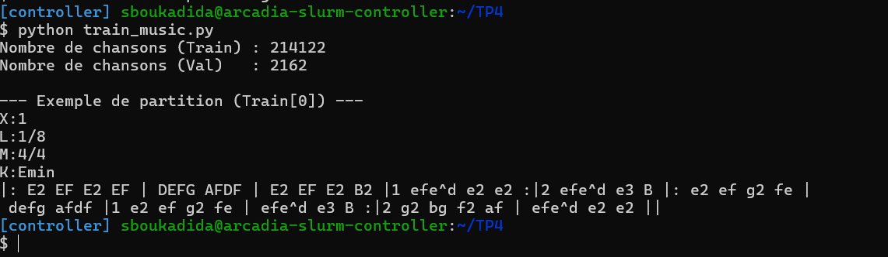

Le jeu de données contient :
- **Entraînement :** 214 122 partitions.
- **Validation :** 2 162 partitions.

**2. Analyse de la première partition ABC**
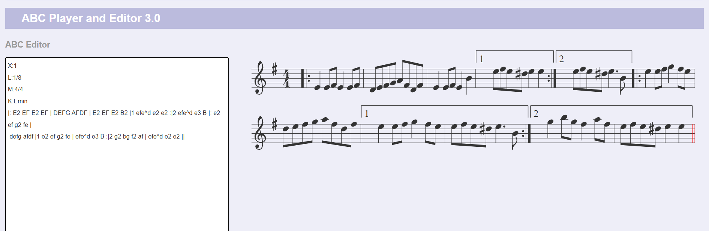
La première partition contient les métadonnées suivantes :

- `X:1` : identifiant de la partition.
- `L:1/8` : durée par défaut des notes, fixée à une croche.
- `M:4/4` : mesure à quatre temps, chaque temps correspondant à une noire.
- `K:Emin` : tonalité de Mi mineur.

Après l'en-tête, les caractères `A-G` et `a-g` représentent les notes musicales, les chiffres indiquent leur durée et les symboles `|`, `|:` et `:|` délimitent les mesures et les répétitions. Le symbole `^` indique une altération (dièse).

Ces métadonnées permettent de définir la structure rythmique et la tonalité nécessaires à l'interprétation de la partition.

### Question 1.b — Construction du vocabulaire et Padding

**1. Statistiques**

- Taille du vocabulaire : **95 caractères**
- Longueur moyenne : **290,1 caractères**
- Longueur maximale : **2 968 caractères**

**2. Pourquoi utiliser sorted() ?**

`sorted()` garantit le même ordre des caractères à chaque exécution. Sans ce tri, les indices pourraient changer et le modèle sauvegardé risquerait de générer des caractères incorrects.

**3. Pourquoi choisir SEQ_LENGTH = 500 plutôt que max_len ?**

La longueur moyenne étant de 290 caractères, fixer SEQ_LENGTH = 500 permet de conserver davantage de contenu musical tout en limitant le padding. Utiliser la longueur maximale de 2 968 caractères augmenterait fortement le temps de calcul et la consommation de mémoire GPU. De plus, le modèle apprendrait sur beaucoup d'espaces ajoutés artificiellement, ce qui pourrait nuire à l'apprentissage des notes musicales.

### Question 2.a — Création du MusicDataset
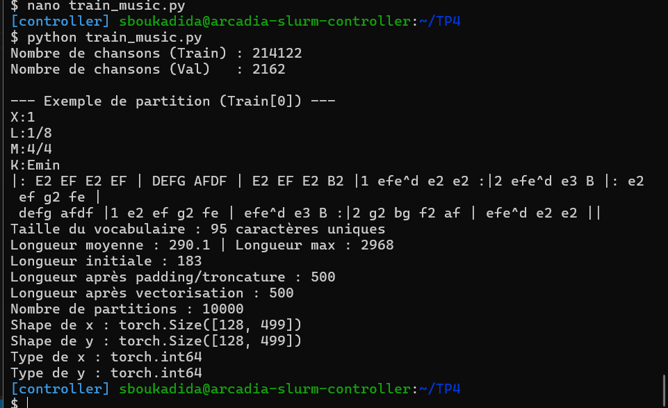
- **Dimensions des tenseurs** :

   Avec SEQ_LENGTH = 500 et BATCH_SIZE = 128, les tenseurs x et y ont la forme (128, 499).

   Chaque batch contient 128 partitions de 499 caractères, car on décale les séquences d'un caractère pour prédire le suivant.

- **Pourquoi utiliser torch.long ?**

  **torch.long** est nécessaire car les caractères sont représentés par des indices entiers utilisés par nn.Embedding. Le type float32 n'est pas adapté à cette indexation.


### Question 2.b — Architecture RNN vs LSTM

**1. Calcul et vérification des paramètres**

Pour `vocab_size = 95`, `embedding_dim = 256` et `hidden_size = 512` :

| Couche | RNN | LSTM |
|---|---:|---:|
| Embedding | 24 320 | 24 320 |
| Récurrente | 394 240 | 1 576 960 |
| Linear | 48 735 | 48 735 |
| **Total** | **467 295** | **1 650 015** |

Calculs :

- Embedding : 95 × 256 = 24 320

- RNN : 512 × (256 + 512 + 2) = 394 240

- LSTM : 4 × 394 240 = 1 576 960

- Linear : 512 × 95 + 95 = 48 735

Le bloc LSTM possède quatre fois plus de paramètres que le RNN, car il utilise quatre transformations (trois portes et un état candidat), chacune avec ses poids et ses deux biais.

Les résultats obtenus avec `count_parameters()` confirment ces calculs.

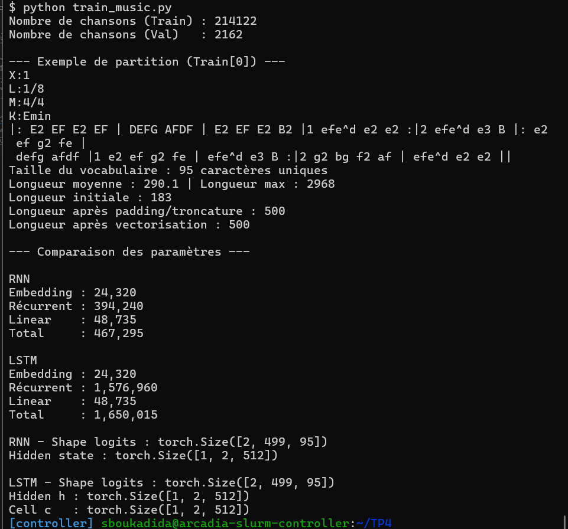

**2. Pourquoi utiliser nn.Embedding ?**

-`nn.Embedding` associe à chaque caractère un vecteur de caractéristiques appris. Contrairement à une couche linéaire qui reçoit directement l'indice scalaire, elle ne suppose pas de relation numérique ou d'ordre entre les caractères. Cela permet au modèle d'apprendre des représentations plus riches et adaptées aux données.

**3. Différence entre les états cachés**

- **`nn.RNN`** retourne un seul état caché `h_n`, qui contient les informations mémorisées par le réseau.
- **`nn.LSTM`** retourne un tuple `(h_n, c_n)` :
  - `h_n` : état caché, représentant les informations utilisées pour produire la sortie.
  - `c_n` : état de cellule, permettant de conserver les informations sur le long terme.

**La principale différence :** le LSTM possède une mémoire supplémentaire (`c_n`) qui lui permet de mieux gérer les dépendances à long terme et de limiter le problème de disparition du gradient.
## Exercice 3 : Entraînement, Dynamique des Gradients et Comparaison RNN vs LSTM 

### Question 3.a — Entraînement et dynamique des gradients


**1. Manipulation des tenseurs**

`CrossEntropyLoss` attend des prédictions de forme `(N, vocab_size)` . Donc
On utilise `logits.reshape(-1, vocab_size)` et `y.reshape(-1)` pour adapter les dimensions des tenseurs.

- `logits` passe de `(batch_size, seq_len, vocab_size)` à `(batch_size * seq_len, vocab_size)`.
- `y` passe de `(batch_size, seq_len)` à `(batch_size * seq_len)`.

La dimension `-1` est calculée automatiquement et correspond à **`batch_size × seq_len`**, soit le nombre total de caractères à prédire dans le batch.

**2. Pourquoi appliquer le Gradient Clipping entre backward() et optimizer.step() ?**

`loss.backward()` calcule les gradients, puis `clip_grad_norm_()` limite leur norme pour éviter l'explosion des gradients. Il faut le faire avant `optimizer.step()`, car c'est à ce moment que les poids sont mis à jour.

**3. Analyse expérimentale (TensorBoard) :**
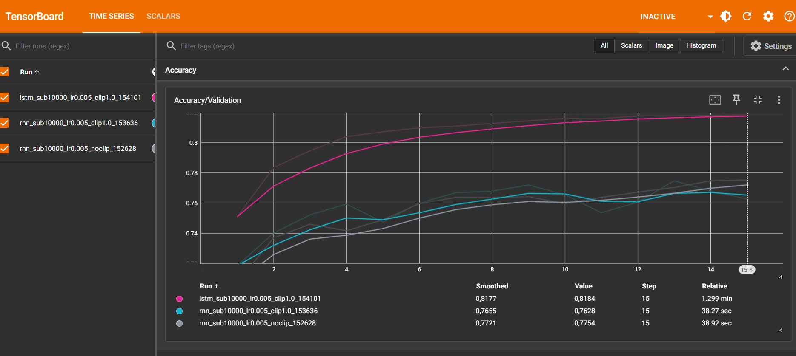
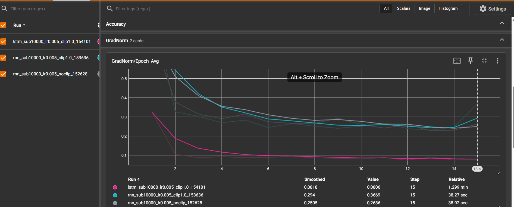
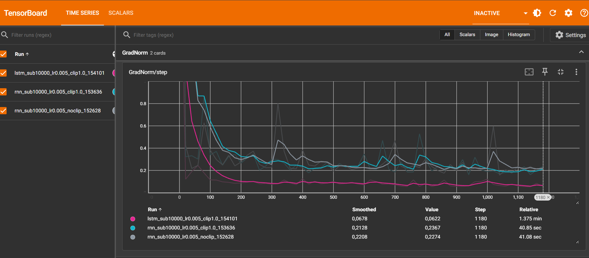

#### 1. Effet du Gradient Clipping (Run 1 vs Run 2)

Les courbes `GradNorm/step` montrent que les deux RNN présentent des fluctuations de gradients, surtout au début de l'entraînement. Les normes diminuent ensuite et se stabilisent globalement autour de 0,2 à 0,3.

Le Run 1 (sans clipping) obtient une Loss de validation finale de **0,7171**, contre **0,7356** pour le Run 2 (avec clipping). 

Dans notre cas, le clipping n'apporte pas d'amélioration visible. Il sert théoriquement à éviter l'explosion des gradients en limitant leur norme à 1. Il évite ainsi des mises à jour trop importantes des poids et rend l'entraînement plus stable.

#### 2. Comparaison RNN et LSTM (Run 2 vs Run 3)

Le LSTM converge nettement plus rapidement que le RNN et obtient de meilleures performances :

| Métrique finale | RNN avec clipping | LSTM avec clipping |
|---|---|---|
| Loss de validation | 0,7356 | **0,5601** |
| Accuracy de validation | 76,28 % | **81,84 %** |


Cette différence s'explique par la mémoire interne du LSTM, mise à jour selon :

$$
c_t = f_t \odot c_{t-1} + i_t \odot \tilde{c}_t
$$

- $f_t$ : porte d'oubli, qui décide quelles informations conserver.
- $i_t$ : porte d'entrée, qui contrôle les nouvelles informations à mémoriser.
- $\tilde{c}_t$ : nouvelles informations candidates.

Lorsque $f_t$ est proche de 1, le LSTM peut conserver des informations sur plusieurs pas de temps et faciliter la propagation du gradient. Il apprend ainsi mieux les dépendances longues, comme les motifs musicaux.


#### 3. Réflexion sur l'Accuracy et le padding

Une partition de 250 caractères contient 250 espaces ajoutés pour atteindre 500 caractères. Le modèle peut facilement prédire ces espaces, ce qui augmente artificiellement l'Accuracy sans forcément mieux prédire les notes.

Pour ignorer les espaces dans la Loss :

```python
loss_fn = nn.CrossEntropyLoss(
    ignore_index=char_to_index[" "]
)
```

Il faut aussi les exclure du calcul de l'Accuracy. Idéalement, on utiliserait un caractère de padding distinct pour ne pas ignorer les vrais espaces des partitions.

## Exercice 4 — Génération musicale
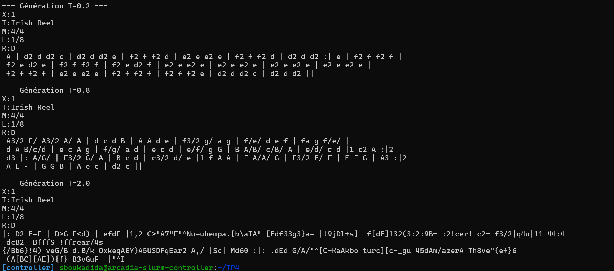
### Question 4.a
1. **Efficacité algorithmique**

   Sans conserver hidden_state, on recalcule toute la séquence à chaque caractère généré, ce qui donne une complexité de O(N²).

   En conservant hidden_state, on traite uniquement le nouveau caractère, ce qui réduit la complexité à O(N).

2. **Rôle de la température T**

-   T → 0⁺ : la distribution se concentre sur le caractère le plus probable. Cela correspond au greedy decoding, qui produit des séquences prévisibles et souvent répétitives.

- T → +∞ : la distribution tend vers une loi uniforme. La génération devient plus aléatoire et diversifiée, mais risque de perdre sa cohérence musicale.

3. **Écoute et analyse qualitative**
   
**Avec T=0.2**
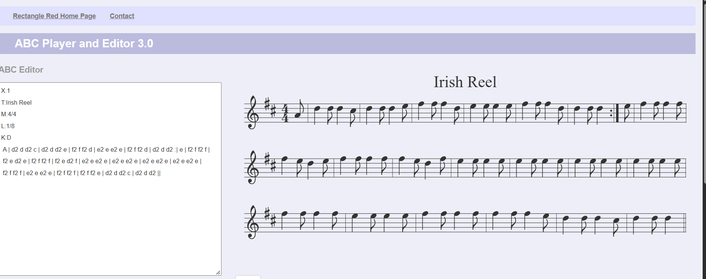
**Avec T=0.8**
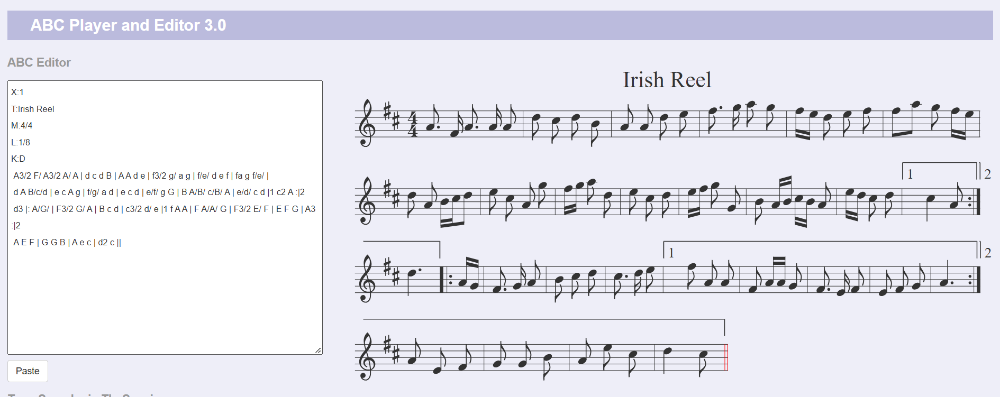
**Avec T=2.0**
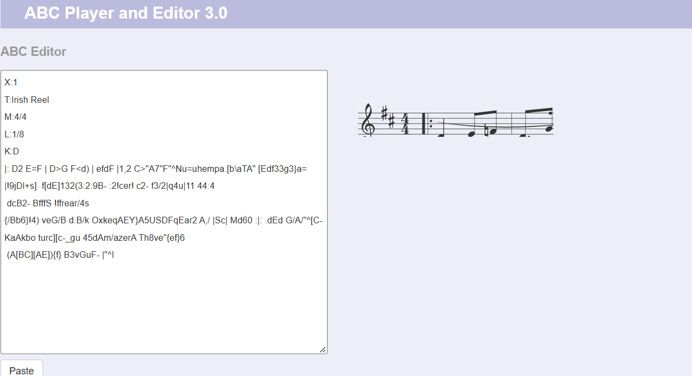
La température influence directement la diversité et la cohérence des partitions générées.
- T = 0.2 : le modèle produit des séquences très répétitives, notamment e2 e e2 e et f2 f f2 f. La structure reste relativement simple, mais le modèle privilégie toujours les mêmes motifs, ce qui limite la richesse musicale.

- T = 0.8 : la génération est plus variée. On observe différentes durées de notes (A3/2, f3/2), des enchaînements plus diversifiés et des symboles de reprise (:|). Cependant, certaines mesures semblent irrégulières. Le résultat est plus intéressant, sans être parfaitement correct musicalement.

- T = 2.0 : le modèle génère des séquences désordonnées, avec des caractères inhabituels et des fragments comme q4u ou OxkeqAEY. La syntaxe ABC devient difficile à interpréter.

Le modèle avec T = 0.8 offre le meilleur équilibre entre diversité et cohérence. Une température faible rend la génération trop prévisible, tandis qu'une température élevée augmente les erreurs de syntaxe.

### Exercice 4.c — Bonus : augmentation des données

Pour améliorer la généralisation du modèle, nous pouvons utiliser la **transposition musicale** comme technique d'augmentation des données.

Le principe consiste à décaler toutes les notes d'une partition d'un même nombre de demi-tons, tout en conservant les intervalles entre les notes. Il faut également adapter la tonalité (`K:`) et les altérations pour que la partition reste musicalement cohérente.

Cette méthode permet de créer plusieurs variantes d'une même mélodie et d'augmenter la diversité des données d'entraînement sans collecter de nouvelles partitions.

Elle pourrait ainsi aider le LSTM à mieux généraliser et à limiter le surapprentissage. Cependant, cette amélioration reste une hypothèse tant qu'elle n'a pas été évaluée expérimentalement.