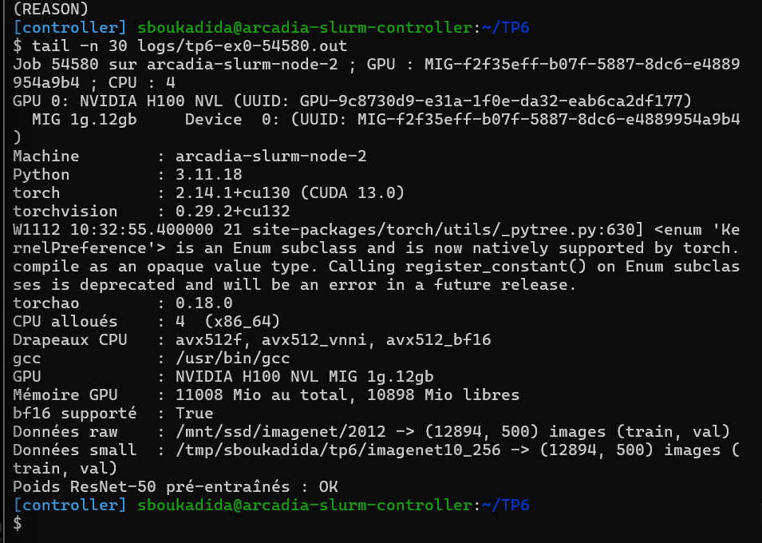
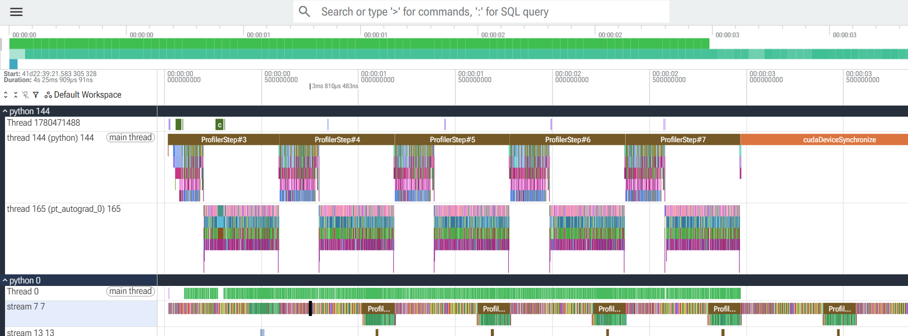
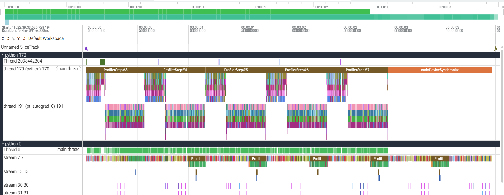

# TP6 — Accélérer un ResNet-50
## Exercice 0 — Mise en place

### 1. Vérification de l'environnement

J'ai exécuté `check_env.py` sur le cluster Arcadia via SLURM. J'ai obtenu les résultats suivants :

### 2. Conséquences du nombre de CPU sur le chargement des images

Je dispose de seulement **4 CPU pour alimenter un septième de GPU H100**. Le décodage JPEG et les transformations des images étant effectués sur le CPU, je m'attends à ce que le chargement des données devienne un goulot d'étranglement.

Le GPU risque donc de rester inactif en attendant les prochains batchs, ce qui réduirait le débit d'entraînement. L'utilisation de plusieurs workers dans le `DataLoader` devrait permettre de limiter ce problème, sans toutefois dépasser les ressources CPU disponibles.

## Exercice 1 — Mesure de référence

### 1. Débit, mémoire et durée d'une époque

J'ai exécuté ResNet-50 en FP32 sur un GPU NVIDIA H100 NVL MIG 1g.12gb, avec un batch de 64 images.

| Configuration | Débit (images/s) | Pic mémoire (Go) | Durée d'une époque |
|---|---:|---:|---:|
| `ref-synth` | 108,2 | 5,95 | — |
| `ref-raw` | 107,9 | 5,95 | 119,5 s |

### 2. Estimation théorique de la mémoire GPU

D'après le cours, j'estime la mémoire nécessaire pour ResNet-50 en FP32, avec **23,5 millions de paramètres**, AdamW et un batch de 64 images.

**Mémoire statique (16 octets par paramètre avec AdamW) :**

`23,5 × 10⁶ × 16 = 376 Mo = 0,376 Go`

**Mémoire des activations (84 Mo par image) :**

`64 × 84 = 5 376 Mo = 5,376 Go`

**Mémoire totale estimée :**

`0,376 + 5,376 = 5,752 Go ≈ 5,75 Go`

J'ai mesuré un pic de **5,95 Go**, soit un écart d'environ **0,20 Go (3,4 %)**. Cet écart s'explique notamment par les buffers temporaires et les espaces de travail cuDNN, non pris en compte dans l'estimation.

Je constate que **les activations dominent la consommation mémoire**, conformément au cours.

### 3. Synchronisation CUDA

L'expérience ref-async montre un écart important entre le retour de l'appel (13,1 ms) et la fin réelle du calcul GPU (591,3 ms).

Cet écart s'explique par l'exécution asynchrone des opérations CUDA : le CPU continue son exécution sans attendre la fin des calculs GPU.

Sans torch.cuda.synchronize(), le chronométrage mesure principalement le lancement des opérations et sous-estime le temps réel d'exécution.

### 4. Batch maximal en FP32

J'ai obtenu un batch maximal de **120 images** en FP32.

Ce résultat correspond à l'ordre de grandeur annoncé dans le cours pour un ResNet-50 sur un MIG H100 d'environ 11,5 Go.

Les erreurs `Out Of Memory` observées pendant la recherche sont attendues : elles correspondent aux essais de batchs dépassant la mémoire disponible.

### 5. Comparaison des données synthétiques et réelles

J'ai mesuré :

- Données synthétiques : **108,2 images/s**.
- Données réelles : **107,9 images/s**.

Je calcule la diminution relative du débit :

`(108,2 - 107,9) / 108,2 × 100 ≈ 0,28 %`

La diminution du débit est donc d'environ **0,28 %**.

J'en conclus qu'avec 3 workers et `pin_memory=True`, le chargement des images ne constitue pas un goulot d'étranglement significatif dans cette configuration. Le débit semble principalement limité par le calcul GPU.

## Exercice 2 — Chargement des données et profilage

### 1. Tableau des débits

J'ai mesuré les débits suivants avec ResNet-50 en FP32, un batch de 64 images et un GPU H100 NVL MIG 1g.12gb.

| Configuration | Workers | Pin memory | Débit (images/s) |
|---|---:|---|---:|
| `raw-w0` | 0 | Oui | 82,4 |
| `raw-w1` | 1 | Oui | 108,1 |
| `raw-w2` | 2 | Oui | 108,0 |
| `raw-w3` | 3 | Oui | 108,0 |
| `raw-w3-nopin` | 3 | Non | 106,1 |
| `small-w0` | 0 | Oui | 92,0 |
| `small-w3` | 3 | Oui | 108,0 |

### 2. Influence du nombre de workers

Le débit passe de **82,4 à 108,1 images/s** entre 0 et 1 worker, soit un gain de **31,2 %**. Il se stabilise ensuite autour de 108 images/s avec 2 et 3 workers.

Avec `--cpus-per-task=4`, un CPU doit rester disponible pour le processus principal d'entraînement. On peut donc utiliser au maximum **3 workers de chargement** sans dépasser les 4 CPU alloués.

### 3. Effet de `pin_memory`

Avec `pin_memory=True`, j'obtiens **108,0 images/s**, contre **106,1 images/s** sans cette option, soit un gain d'environ **1,8 %**.

`pin_memory` place les données dans une mémoire RAM verrouillée (*pinned memory*), ce qui facilite et accélère leur transfert du CPU vers le GPU, notamment avec des copies asynchrones.

### 4. Pourquoi la copie redimensionnée (`small`) se charge-t-elle plus vite ? Le modèle voit-il des images différentes ?

La copie `small` se charge plus vite car les images sont déjà redimensionnées à 256 pixels, ce qui réduit le volume de données à lire et le temps de décodage.

**Non, le modèle ne voit pas d'images fondamentalement différentes** : dans les deux cas, il reçoit des images de 224 × 224 pixels après les transformations. Seules de légères différences de pixels peuvent apparaître à cause du pré-redimensionnement.

### 5. Estimation du temps de décodage

Avec 0 worker, le décodage et le calcul sont séquentiels. On utilise la formule :

`1 / D₀ ≈ t_d + 1 / D_synth`

D'où :

`t_d ≈ 1 / D₀ - 1 / D_synth`

Avec `D_synth = 108,2 images/s` :

**Pour les images `raw` :**

`t_d = 1 / 82,4 - 1 / 108,2 ≈ 2,89 ms/image`

**Pour les images `small` :**

`t_d = 1 / 92,0 - 1 / 108,2 ≈ 1,63 ms/image`

On estime alors la capacité de préparation d'un worker :

| Données | Temps estimé par image | Débit estimé d'un worker | Capacité de 3 workers |
|---|---:|---:|---:|
| `raw` | 2,89 ms | 346 images/s | 1 037 images/s |
| `small` | 1,63 ms | 614 images/s | 1 843 images/s |

Dans ce modèle simplifié, **3 workers ne suffiraient plus au-delà d'environ 1 037 images/s pour `raw`**, contre **1 843 images/s pour `small`**.

### 6. Analyse des traces du profiler

**Trace `raw-w3`**

La trace montre des opérations CUDA nombreuses et rapprochées, qui s'enchaînent presque continuellement, avec une durée de pas d'environ 590 ms dans la trace profilée. L'attente du DataLoader est très faible.

J'identifie donc un profil limité par le calcul GPU (compute-bound), et non par le chargement des données (data-bound) ou le lancement des opérations (launch-bound).

**Trace `small-w3`**

J'observe un comportement similaire : les opérations CUDA s'enchaînent presque sans interruption, avec très peu de périodes d'inactivité du GPU et une attente négligeable du DataLoader.

Cette configuration présente également un profil limité par le calcul GPU (compute-bound). Le pré-redimensionnement ne procure donc pas de gain supplémentaire avec 3 workers.

### 7. Fraction du débit synthétique atteinte

Le meilleur débit réel est de **108,1 images/s** (`raw-w1`), contre **108,2 images/s** pour `ref-synth`.

`Fraction = 108,1 / 108,2 × 100 ≈ 99,91 %`

J'atteins donc **99,91 % du débit synthétique**, ce qui montre que le chargement des données est suffisamment optimisé pour cette configuration FP32.
## Exercice 3 — Accélération du calcul GPU

### 1. Mesures de `ex3.sh`

J'ai mesuré les performances de ResNet50 sur un GPU NVIDIA H100 NVL MIG 1g.12gb, avec un batch de 64 images.

| Configuration | Données | Débit (img/s) | Pic mémoire (Go) | Compilation (s) |
|---|---|---:|---:|---:|
| FP32 | synthetic | 108,2 | 5,95 | — |
| TF32 | synthetic | 259,2 | 5,93 | — |
| BF16 | synthetic | 382,4 | 3,29 | — |
| BF16 + `channels_last` | synthetic | 526,5 | 3,29 | — |
| BF16 + `channels_last` + `compile` | synthetic | 669,7 | 3,08 | 66,4 |
| BF16 + `channels_last`, 1 worker | raw | 214,4 | 3,29 | — |
| BF16 + `channels_last` + `compile`, 1 worker | raw | 204,6 | 3,07 | 8,9 |
| BF16 + `channels_last`, 3 workers | raw | 522,1 | 3,29 | — |
| BF16 + `channels_last` + `compile`, 3 workers | raw | 669,7 | 3,07 | 4,4 |
| BF16 + `channels_last`, 1 worker | small | 322,1 | 3,29 | — |
| BF16 + `channels_last` + `compile`, 1 worker | small | 473,8 | 3,07 | 7,2 |
| BF16 + `channels_last`, 3 workers | small | 522,0 | 3,29 | — |
| BF16 + `channels_last` + `compile`, 3 workers | small | 670,5 | 3,07 | 6,6 |

Le batch maximal mesuré en BF16 est de **240 images**.

### 2. Comparaison entre `fp32-synthetic` et `ref-synth`

J'obtiens **108,2 images/s** pour `fp32-synthetic`, contre **108,2 images/s** pour `ref-synth` dans l'exercice 1.

L'écart relatif est donc :

$$
\frac{|108{,}2 - 108{,}2|}{108{,}2} \times 100 = 0\,\%
$$

Les deux mesures sont identiques à la précision affichée. J'en déduis que mes mesures sont reproductibles dans ces conditions et que les gains importants observés dans cet exercice sont significatifs. Cela ne garantit toutefois pas une absence totale de variabilité.
### 3. Facteurs de gain des optimisations en données synthétiques

| Étape | Débit (images/s) | Gain par rapport à l'étape précédente |
|---|---:|---:|
| FP32 (référence) | 108,2 | ×1,00 |
| TF32 | 259,2 | ×2,40 |
| BF16 | 382,4 | ×1,48 |
| BF16 + `channels_last` | 526,5 | ×1,38 |
| BF16 + `channels_last` + `compile` | 669,7 | ×1,27 |

J'explique ces gains par les mécanismes d'accélération suivants :

- **TF32 (×2,40 — Tensor Cores) :** en FP32 classique, les calculs sont principalement effectués par les unités CUDA. Le TF32 permet d'utiliser les **Tensor Cores**, spécialisés dans les multiplications matricielles et les convolutions. Ils exécutent davantage d'opérations en parallèle, ce qui explique le gain important, sans réduire la taille des données stockées.

- **BF16 (×1,48 — Tensor Cores et trafic mémoire) :** le BF16 exploite également les Tensor Cores, avec des calculs en précision réduite. Les activations passent de **32 bits à 16 bits**, ce qui diminue leur taille et le **trafic mémoire** entre la mémoire GPU et les unités de calcul. Le GPU passe donc moins de temps à transférer les données.

- **`channels_last` (×1,38 — organisation mémoire) :** ce format organise les données de manière plus adaptée aux convolutions optimisées. Il améliore l'efficacité des accès mémoire et facilite l'utilisation des Tensor Cores, ce qui réduit les coûts liés à la manipulation des données.

- **`torch.compile` (×1,27 — fusion des opérations) :** la compilation permet de **fusionner plusieurs opérations (*kernel fusion*)** en un seul kernel CUDA. Cela évite certaines écritures et lectures intermédiaires en mémoire GPU et réduit le nombre de lancements de kernels, ce qui améliore le débit.

**Au total, j'obtiens une accélération de ×6,19 par rapport au FP32.** Les Tensor Cores accélèrent les calculs, le BF16 et `channels_last` améliorent l'efficacité des accès mémoire, et `torch.compile` réduit les opérations intermédiaires grâce à la fusion.

### 4. Comparaison des débits synthétiques et réels

| Configuration | Données | 1 worker (img/s) | 3 workers (img/s) | Synthétique (img/s) |
|---|---|---:|---:|---:|
| BF16 + `channels_last` | raw | 214,4 | 522,1 | 526,5 |
| BF16 + `channels_last` | small | 322,1 | 522,0 | 526,5 |
| BF16 + `channels_last` + `compile` | raw | 204,6 | 669,7 | 669,7 |
| BF16 + `channels_last` + `compile` | small | 473,8 | 670,5 | 669,7 |

Dans l'exercice 2, j'avais estimé qu'un worker pouvait fournir environ **346 images/s** pour `raw` et **614 images/s** pour `small`. Ces estimations prévoyaient qu'un seul worker risquait de devenir insuffisant après l'accélération du GPU, tandis que trois workers pourraient mieux alimenter l'entraînement. Les résultats confirment cette tendance.

Avec **1 worker**, le chargement des données constitue le principal goulot d'étranglement, particulièrement pour `raw`. Avec **3 workers**, les débits rejoignent presque les performances synthétiques : le calcul GPU redevient le facteur limitant.

Sur `raw` avec 1 worker, `compile` fait passer le débit de 214,4 à 204,6 images/s : je ne mesure donc aucun gain. Sur `small`, il améliore le débit de 322,1 à 473,8 images/s, car le chargement est moins limitant.

J'observe également une forte dispersion avec 1 worker, notamment pour `raw` compilé (181,9 à 274,5 images/s), contre seulement 666,4 à 670,5 images/s avec 3 workers. Cela traduit une sensibilité aux variations de disponibilité du CPU et du chargement des données.

Selon la **loi d'Amdahl**, accélérer le calcul GPU apporte peu de bénéfices lorsque le chargement des données représente la partie dominante du temps d'exécution.

### 5. Nombre de workers nécessaire sur un H100 entier

Un H100 entier possède environ **7 fois plus de multiprocesseurs** que le MIG utilisé.

En supposant que le débit de calcul augmente proportionnellement, j'estime le débit cible à :

$$
7 \times 670 \approx 4\,690\ \text{images/s}
$$

En utilisant les débits observés avec 1 worker comme ordre de grandeur, j'obtiens :

- Pour `raw` : environ **23 workers** (4 690 ÷ 204,6).
- Pour `small` : environ **10 workers** (4 690 ÷ 473,8).

J'estime donc qu'il faudrait **environ 10 à 25 workers**, selon le prétraitement des images et les performances réelles du chargement.

Les **30 cœurs du nœud Arcadia** pourraient théoriquement suffire pour alimenter un H100 entier. Cependant, les ressources nécessaires à l'entraînement, les variations de charge CPU et les autres processus peuvent réduire cette marge. Il faudrait le vérifier expérimentalement.

### 6. Coût et amortissement de la compilation

J'obtiens les temps de compilation suivants :

| Configuration compilée | Temps de compilation |
|---|---:|
| synthetic | 66,4 s |
| raw, 1 worker | 8,9 s |
| raw, 3 workers | 4,4 s |
| small, 1 worker | 7,2 s |
| small, 3 workers | 6,6 s |

La première compilation est beaucoup plus longue. Les suivantes bénéficient vraisemblablement de la **mise en cache des artefacts de compilation**, ce qui réduit leur coût initial.

Pour calculer l'amortissement, je compare les configurations synthétiques BF16 + `channels_last`, avec et sans compilation, pour un batch de 64 images.

Temps par itération sans compilation :

$$
t_{\mathrm{sans}} = \frac{64}{526{,}5} \approx 0{,}1216\ \text{s}
$$

Temps par itération avec compilation :

$$
t_{\mathrm{avec}} = \frac{64}{669{,}7} \approx 0{,}0956\ \text{s}
$$

Le gain est donc d'environ **0,026 seconde par itération**.

Sans bénéficier du cache, le nombre d'itérations nécessaires pour amortir les 66,4 secondes de compilation est :

$$
N = \frac{66{,}4}{0{,}026} \approx 2\,554\ \text{itérations}
$$

Avec le cache, en prenant le coût de compilation de 4,4 secondes observé pour `raw` avec 3 workers :

$$
N = \frac{4{,}4}{0{,}026} \approx 169\ \text{itérations}
$$

Pour **deux époques de 201 pas**, soit 402 itérations :

- **Sans cache :** la compilation n'est pas amortie.
- **Avec cache :** la compilation peut être amortie, puisque 402 dépasse 169 itérations.

J'en conclus que `torch.compile` est particulièrement intéressant lorsque l'entraînement est suffisamment long ou lorsque les artefacts de compilation peuvent être réutilisés. Ce calcul suppose que le débit reste proche de celui mesuré avec les données synthétiques.

### 7. Comparaison du batch maximal en BF16 et FP32

J'ai obtenu les résultats suivants :

| Précision | Batch maximal |
|---|---:|
| FP32 | 120 |
| BF16 + `channels_last` | 240 |

Le rapport est :

$$
\frac{240}{120} = 2
$$

Le batch maximal est donc **doublé** en BF16, ce qui correspond à la tendance prédite par le cours.

En effet, les activations en BF16 occupent **2 octets par élément**, contre **4 octets en FP32**. La mémoire nécessaire aux activations diminue donc approximativement de moitié.

Le rapport n'est toutefois pas nécessairement exactement égal à 2 dans toutes les situations, car une partie de la mémoire reste occupée par les paramètres, les gradients, les états de l'optimiseur et les espaces de travail temporaires.

### 8. Entraînement sur deux époques

J'ai entraîné le ResNet50 pendant deux époques avec BF16, `channels_last`, `torch.compile`, 3 workers et les données `small`.

| Époque | Temps (s) | Débit (img/s) | Top-1 validation |
|---|---:|---:|---:|
| 0 | 59,5 | 216 | 99,2 % |
| 1 | 12,6 | 1 019 | 99,2 % |

La première époque est plus lente principalement à cause de la compilation initiale du modèle avec `torch.compile`. Les compilations étant réutilisées, la deuxième époque s'exécute beaucoup plus rapidement.

Par rapport à ref-raw (119,5 s), la deuxième époque (12,6 s) est 9,48 fois plus rapide. Ce gain global résulte des optimisations GPU et du changement de données de raw vers small.

# Exercice 4 — Entraînement multi-GPU avec DDP

## 1. Transport NCCL et débit réseau

D'après `logs/nccl-54851.log`, NCCL utilise le transport **Socket TCP/IP** sur l'interface `ens18`, car aucun périphérique InfiniBand n'a été détecté.

Pour un all-reduce de 102 Mo entre deux nœuds, j'obtiens :

- Durée : **877,4 ms**
- Débit algorithmique : **0,12 Go/s**
- Débit par lien : **0,12 Go/s**

Conversion : `0,12 × 8 = 0,96 Gbit/s`.

Ce débit est proche de celui d'un **lien Ethernet à 1 Gbit/s**. Il s'agit d'une estimation du débit effectif, et non d'une confirmation de la vitesse nominale du réseau.

## 2. Comparaison des performances

| Configuration | Temps/pas (ms) | Débit (images/s) | Accélération S | Efficacité E |
|---|---:|---:|---:|---:|
| l4-x1 | 138,2 | 463,2 | 1,00 | — |
| l4-x2 | 866,3 | 147,8 | 0,32 | 16,0 % |
| l4-x2-bf16hook | 462,8 | 276,6 | 0,60 | 29,9 % |
| l4-x1-accum8 | 1 051,4 | 487,0 | 1,00 | — |
| l4-x2-accum8-bf16hook | 1 374,6 | 744,9 | 1,53 | 76,5 % |

J'ai calculé l'accélération par `S = D₂ / D₁`, en utilisant la référence à un GPU avec la même accumulation. L'efficacité est `E = S / 2` pour les configurations à deux GPU.

Le DDP classique ralentit l'entraînement à cause des communications. En revanche, la combinaison de l'accumulation et de la compression BF16 atteint une accélération de **1,53×** par rapport à un GPU avec accumulation ×8.

La sixième mesure correspond au test NCCL : **877,4 ms pour 102 Mo**, avec un débit de **0,12 Go/s**.

## 3. Estimation du coût de communication

Le modèle contient 23,5 millions de paramètres, soit environ **94 Mo de gradients FP32**.

En supposant un temps proportionnel à la taille des données :

`t_c = 877,4 × 94 / 102 ≈ 808,6 ms`

Pour un GPU, je mesure `t₁ = 138,2 ms`.

Les deux limites théoriques sont :

- Sans recouvrement : `t₁ + t_c = 946,8 ms`
- Avec recouvrement parfait : `max(t₁, t_c) = 808,6 ms`

Le temps mesuré sur deux nœuds est **866,3 ms**, compris entre ces deux limites.

J'estime donc le temps de communication masqué par le calcul :

`t_rec = 946,8 − 866,3 = 80,5 ms`

Environ **80,5 ms de communication sont recouverts par le calcul**. Cette estimation suppose que le coût de calcul par GPU reste comparable entre les configurations.

## 4. Effet de `--bf16-hook`

Avec le hook BF16, le temps par pas passe de **866,3 ms à 462,8 ms**, et le débit de **147,8 à 276,6 images/s**, soit un gain de **1,87×**.

Le hook compresse les gradients FP32 en BF16 avant leur communication, ce qui réduit approximativement de moitié le volume transféré. Le réseau étant lent, cette réduction améliore fortement les performances.

Le risque est une **perte de précision numérique** pendant la réduction des gradients, susceptible d'affecter la convergence et la qualité finale du modèle.

## 5. Loi d'Amdahl et prédiction avec accumulation

La loi d'Amdahl classique ne suffit pas ici, car elle suppose une fraction séquentielle fixe et ne modélise pas explicitement les communications réseau, leur recouvrement avec le calcul ni la compression des gradients.

Pour `k = 8` micro-batchs, j'utilise :

`T₂ ≈ k × t₁ + t_c − t_rec`

Avec compression BF16, j'estime le coût de communication à la moitié du coût FP32 :

`t_c,BF16 ≈ 808,6 / 2 = 404,3 ms`

En reprenant le recouvrement estimé à la question 3 :

`T₂ ≈ 8 × 138,2 + 404,3 − 80,5`

**Temps prédit : 1 429,4 ms**

**Temps mesuré : 1 374,6 ms**

L'écart relatif est d'environ **4,0 %** par rapport à la mesure. Le modèle fournit donc une approximation raisonnable, malgré ses hypothèses simplificatrices sur le recouvrement et les coûts de calcul.

## 6. Rentabilité du DDP multi-nœuds

Le DDP devient rentable lorsque le temps de calcul effectué entre deux synchronisations est suffisamment important pour amortir le coût des communications.

Deux leviers permettent d'améliorer la rentabilité :

- **Accumulation de gradients :** je réduis la fréquence des communications, au prix d'un batch effectif plus grand et de mises à jour moins fréquentes des paramètres.
- **Compression BF16 :** je réduis le volume de gradients transmis, au prix d'une perte de précision numérique.

Sur ce réseau, la combinaison des deux permet de dépasser le débit de la référence à un GPU avec la même accumulation.

## 7. Ajustement du taux d'apprentissage

Le batch effectif passe de 64 à 128 avec deux GPU, puis à 1 024 avec l'accumulation ×8.

Pour un véritable entraînement :

- **Avec AdamW :** je privilégierais un ajustement prudent du taux d'apprentissage, éventuellement selon une règle en racine carrée du facteur d'augmentation du batch, avec une phase de warmup et une validation expérimentale.
- **Avec SGD :** je pourrais appliquer la règle de mise à l'échelle linéaire du taux d'apprentissage avec le batch, également accompagnée d'un warmup.

Par rapport à un batch de 64, le facteur d'augmentation est de 2 pour un batch de 128 et de 16 pour un batch de 1 024. Ces règles restent des points de départ à valider expérimentalement.

## 8. Initialisation, échantillonnage et synchronisation

Tous les processus utilisent la **même graine d'initialisation** afin de démarrer avec des paramètres identiques. Ils traitent cependant des données différentes grâce au `DistributedSampler`, ce qui permet de répartir le travail entre les GPU.

Si j'oublie `sampler.set_epoch(epoch)` dans la branche `small`, le mélange des données reste identique à chaque époque. Cela réduit la diversité de l'ordre d'apprentissage, même si les processus continuent de recevoir leurs partitions respectives.

Si j'oublie `model.no_sync()` pendant l'accumulation, DDP synchronise les gradients après chaque micro-batch au lieu de les synchroniser uniquement à la fin de l'accumulation. Le résultat mathématique reste en principe comparable, mais le coût de communication augmente fortement et l'intérêt de l'accumulation pour les performances disparaît en grande partie.
# Exercice 5 — Quantification INT8 sur CPU

## 1. Résultats de la calibration avec 200 images

J'ai évalué quatre variantes de mon ResNet50 entraîné (`best.pth`) sur CPU, avec 4 threads et 500 images de validation.

| Variante | Taille (Mo) | Latence (ms) | Premier appel (s) | Top-1 |
|---|---:|---:|---:|---:|
| FP32 sans compilation | 94,3 | 50,87 | 0,1 | 99,2 % |
| FP32 compilé | 94,3 | 21,23 | 28,8 | 99,2 % |
| BF16 compilé | 47,2 | 11,88 | 5,3 | 99,2 % |
| INT8 compilé | 23,9 | 7,34 | 8,0 | 98,8 % |

L'INT8 compilé présente la latence la plus faible et la taille de poids la plus réduite. Il entraîne toutefois une légère baisse du top-1 de **99,2 % à 98,8 %**, soit **0,4 point de pourcentage**.

## 2. Rapport de taille FP32 / INT8

Le rapport de taille est :

`94,3 / 23,9 ≈ 3,95`

La taille des poids est donc réduite d'environ **3,95 fois**.

Ce rapport est proche de 4, mais pas exactement égal à 4, car la quantification nécessite des métadonnées (échelles et points zéro) et certains tenseurs peuvent rester dans une autre précision.

La fonction `weights_mb` mesure les poids effectivement utilisés par le graphe de calcul. Utiliser directement la taille du `state_dict` pourrait surestimer la mémoire nécessaire, car le modèle converti peut conserver des poids d'origine qui ne sont plus utilisés pour l'inférence.

## 3. Comparaison des latences

La compilation réduit la latence FP32 de **50,87 à 21,23 ms**, soit un gain de :

`50,87 / 21,23 ≈ 2,40×`

En comparant l'INT8 au FP32 compilé :

`21,23 / 7,34 ≈ 2,89×`

L'INT8 est donc **2,89 fois plus rapide** que le FP32 compilé, avec une légère perte de précision.

Je prends le FP32 compilé comme référence pour isoler davantage l'effet de la quantification, puisque les deux variantes bénéficient de la compilation.

Ce gain est cohérent avec la présence de `avx512_vnni` sur le CPU, qui accélère les calculs entiers.

## 4. Précision et rôle de la calibration

J'ai comparé la quantification INT8 avec 200 et 10 images de calibration.

| Calibration INT8 | Top-1 | Accord FP32 | Écart moyen des logits |
|---|---:|---:|---:|
| 200 images | 98,8 % | 99,6 % | 0,0812 |
| 10 images | 99,0 % | 99,8 % | 0,0845 |

Avec 200 images, l'INT8 conserve **99,6 % des prédictions du FP32**, mais son top-1 diminue de 0,4 point. Avec 10 images, le top-1 est légèrement supérieur sur ce jeu de validation.

En revanche, la calibration sur 200 images produit un écart moyen des logits plus faible (**0,0812 contre 0,0845**).

La calibration sert à estimer les plages de valeurs des activations pour déterminer les paramètres de quantification. Ces résultats montrent que le nombre d'images de calibration influence les sorties du modèle, sans garantir qu'une calibration plus grande donne systématiquement un meilleur top-1.

## 5. Influence du nombre de threads

| Variante | 1 thread (ms) | 4 threads (ms) | Accélération |
|---|---:|---:|---:|
| FP32 compilé | 99,81 | 21,23 | 4,70× |
| INT8 compilé | 29,71 | 7,34 | 4,05× |

Avec 4 threads, la latence diminue fortement pour les deux variantes. Les rapports mesurés sont proches ou supérieurs à 4, ce qui peut notamment refléter la variabilité des mesures et les différences de comportement des noyaux de calcul.

Les évaluations de précision à 1 thread portent sur 100 images, contre 500 pour les configurations à 4 threads. Je ne compare donc pas directement leurs top-1.

Pour le déploiement, je retiens **4 threads**, qui offrent les meilleures latences mesurées.

## 6. Quantification dynamique sur ResNet

La quantification dynamique est surtout efficace pour les modèles dominés par des couches linéaires, car elle quantifie les activations pendant l'exécution.

Or, ResNet50 repose principalement sur des **couches convolutionnelles**. La quantification dynamique classique ne permet donc pas d'accélérer efficacement la majorité de ses calculs.

Je privilégie la **quantification statique INT8**, qui utilise une calibration des activations et permet d'exploiter des noyaux convolutionnels INT8 optimisés sur CPU.
## Synthèse finale du TP6

### 1. Tableau comparatif des configurations

J'ai regroupé les mesures des exercices 1 à 5 afin de comparer les performances du ResNet50 selon la précision, les optimisations, le chargement des données et le matériel utilisé.

#### Entraînement sur un GPU

| Configuration | Matériel | Données | Débit (img/s) | Pic mémoire (Go) | Époque (s) |
|---|---|---|---:|---:|---:|
| Référence FP32 synthétique | H100 MIG | Synthétiques | 108,2 | 5,95 | — |
| Référence FP32 réelle | H100 MIG | Raw, 3 workers | 107,9 | 5,95 | 119,5 |
| FP32, 0 worker | H100 MIG | Raw | 82,4 | — | — |
| FP32, 1 worker | H100 MIG | Raw | 108,1 | — | — |
| FP32, 2 workers | H100 MIG | Raw | 108,0 | — | — |
| FP32, 3 workers | H100 MIG | Raw | 108,0 | — | — |
| FP32, 3 workers, sans pin | H100 MIG | Raw | 106,1 | — | — |
| FP32, 0 worker | H100 MIG | Small | 92,0 | — | — |
| FP32, 3 workers | H100 MIG | Small | 108,0 | — | — |
| TF32 | H100 MIG | Synthétiques | 259,2 | 5,93 | — |
| BF16 | H100 MIG | Synthétiques | 382,4 | 3,29 | — |
| BF16 + channels_last | H100 MIG | Synthétiques | 526,5 | 3,29 | — |
| BF16 + channels_last + compile | H100 MIG | Synthétiques | 669,7 | 3,08 | — |
| BF16 + channels_last, 1 worker | H100 MIG | Raw | 214,4 | 3,29 | — |
| BF16 + channels_last + compile, 1 worker | H100 MIG | Raw | 204,6 | 3,07 | — |
| BF16 + channels_last, 3 workers | H100 MIG | Raw | 522,1 | 3,29 | — |
| BF16 + channels_last + compile, 3 workers | H100 MIG | Raw | 669,7 | 3,07 | — |
| BF16 + channels_last, 1 worker | H100 MIG | Small | 322,1 | 3,29 | — |
| BF16 + channels_last + compile, 1 worker | H100 MIG | Small | 473,8 | 3,07 | — |
| BF16 + channels_last, 3 workers | H100 MIG | Small | 522,0 | 3,29 | — |
| BF16 + channels_last + compile, 3 workers | H100 MIG | Small | **670,5** | 3,07 | — |
| BF16 + channels_last + compile, époque 0 | H100 MIG | Small, 3 workers | 216,3 | — | 59,5 |
| BF16 + channels_last + compile, époque 1 | H100 MIG | Small, 3 workers | 1 019,3 | — | 12,6 |

Sur données synthétiques, les optimisations font passer le débit de **108,2 à 669,7 images/s**, soit **6,19×**. Avec les données réelles `small` et 3 workers, le meilleur benchmark atteint **670,5 images/s**. Les débits des époques complètes sont présentés séparément, car leur protocole de mesure est différent.

#### Entraînement distribué (DDP)

| Configuration | Matériel | Données | Débit global (img/s) | Pic mémoire (Go) | Époque (s) |
|---|---|---|---:|---:|---:|
| BF16, 1 GPU | 1 × L4 | Synthétiques | 463,2 | — | — |
| BF16, 2 GPU | 2 × L4 | Synthétiques | 147,8 | — | — |
| BF16, 2 GPU, hook BF16 | 2 × L4 | Synthétiques | 276,6 | — | — |
| BF16, 1 GPU, accumulation ×8 | 1 × L4 | Synthétiques | 487,0 | — | — |
| BF16, 2 GPU, accumulation ×8, hook BF16 | 2 × L4 | Synthétiques | **744,9** | — | — |

La meilleure configuration DDP atteint **744,9 images/s** avec deux GPU L4, une accumulation de gradients de 8 et un hook de communication BF16. Les mesures de mémoire et de temps par époque n'ont pas été réalisées pour ces configurations.

#### Inférence CPU

| Configuration | Matériel | Données | Débit estimé (img/s) | Pic mémoire | Latence (ms) |
|---|---|---|---:|---|---:|
| FP32 eager, 4 threads | CPU | Validation (500) | 19,7 | — | 50,87 |
| FP32 compilé, 4 threads | CPU | Validation (500) | 47,1 | — | 21,23 |
| BF16 compilé, 4 threads | CPU | Validation (500) | 84,2 | — | 11,88 |
| INT8, calibration 200, 4 threads | CPU | Validation (500) | **136,2** | — | 7,34 |
| INT8, calibration 10, 4 threads | CPU | Validation (500) | 89,7 | — | 11,15 |
| FP32 compilé, 1 thread | CPU | Validation (100) | 10,0 | — | 99,81 |
| INT8, 1 thread | CPU | Validation (100) | 33,7 | — | 29,71 |

Pour l'inférence CPU, j'ai estimé le débit par `1000 / latence_ms`, avec un batch de 1. Le pic mémoire n'a pas été mesuré. Les latences correspondent aux mesures expérimentales du job 54902, réalisées avec mon checkpoint `best.pth`.

Les performances des GPU H100 MIG et L4 ne sont pas directement comparables, car il s'agit de matériels différents. De même, les mesures d'inférence CPU concernent un autre type de calcul que l'entraînement GPU.

### 2. Analyse des performances DDP

Avec deux GPU L4, l'accélération idéale serait de **2×**, soit un débit de **926,4 images/s** à partir de la référence à un GPU (463,2 images/s).

Or, je mesure seulement **147,8 images/s** en DDP classique, soit une accélération de **0,32×** et une efficacité de **16 %**. Cette dégradation s'explique principalement par les communications réseau : NCCL utilise Socket TCP/IP, avec un débit mesuré de 0,12 Go/s et un all-reduce de 102 Mo nécessitant 877,4 ms, contre seulement 138,2 ms de calcul par pas sur un GPU.

La synchronisation des gradients devient donc le principal goulot d'étranglement. Le chargement des données n'est pas responsable de cet écart, puisque les mesures DDP utilisent des données synthétiques.

Avec le hook BF16, le débit atteint **276,6 images/s** grâce à la réduction du volume de gradients échangés. En combinant ce hook avec une accumulation de 8 micro-batchs, j'obtiens **744,9 images/s**, soit une accélération de **1,53×** et une efficacité de **76,5 %** par rapport à la référence à un GPU avec la même accumulation.

J'en conclus que le DDP multi-nœuds n'est rentable sur ce réseau que lorsque les communications sont suffisamment réduites ou amorties par le calcul.

### 3. Recommandations finales

#### Configuration recommandée pour l'entraînement GPU

Je recommande d'utiliser **un GPU H100 MIG**, avec la précision **BF16**, le format mémoire **`channels_last`**, **`torch.compile`**, ainsi qu'un `DataLoader` avec **3 workers** et `pin_memory=True`.

Avec les données `small` et 3 workers, cette configuration atteint **670,5 images/s**, contre **108,0 images/s** en FP32 avec les mêmes données et le même nombre de workers. Son pic mémoire est de **3,07 Go** (contre **5,95 Go** pour la référence FP32 synthétique). L'entraînement réel atteint **12,6 s par époque** après la première compilation, avec un top-1 de validation de **99,2 %**.

Je privilégie un seul GPU plutôt que le DDP multi-nœuds classique, car les communications réseau pénalisent fortement les performances. Si plusieurs GPU doivent être utilisés, je recommande l'accumulation de gradients et le hook BF16, qui permettent d'atteindre **76,5 % d'efficacité** sur deux GPU L4.

#### Configuration recommandée pour l'inférence CPU

Je recommande la **quantification statique INT8 compilée**, avec une calibration sur **200 images** et **4 threads CPU**. Parmi les calibrations testées, cette configuration présente la plus faible latence mesurée et le plus faible écart moyen des logits.

Avec mon checkpoint `best.pth`, elle atteint **7,34 ms**, contre **21,23 ms** en FP32 compilé, soit une accélération de **2,89×**. La taille des poids passe de **94,3 à 23,9 Mo**. Le top-1 sur les 500 images de validation passe de **99,2 % en FP32 à 98,8 % en INT8**, soit une perte de **0,4 point de pourcentage**, que je considère acceptable au regard des gains de latence et de taille.